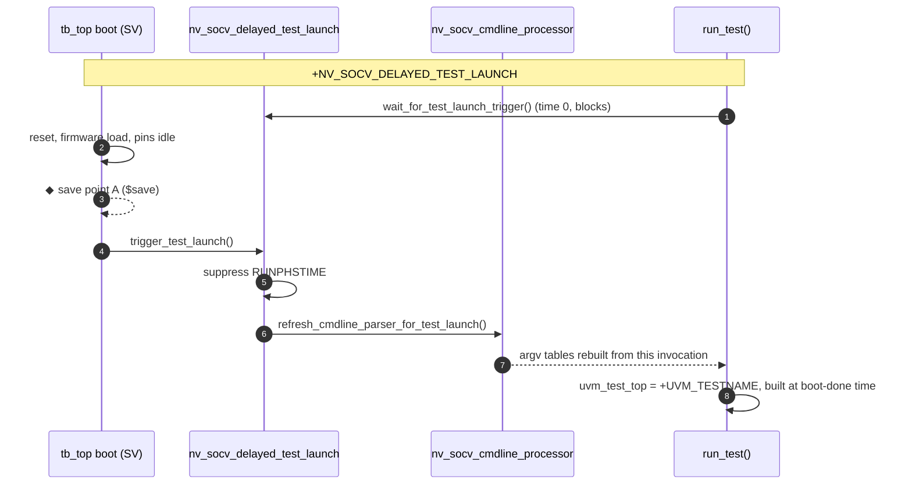
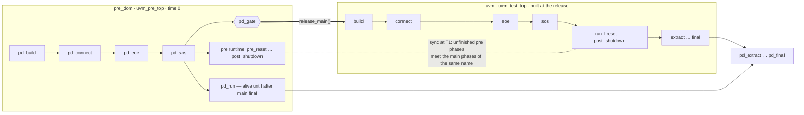
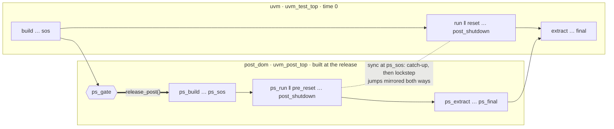
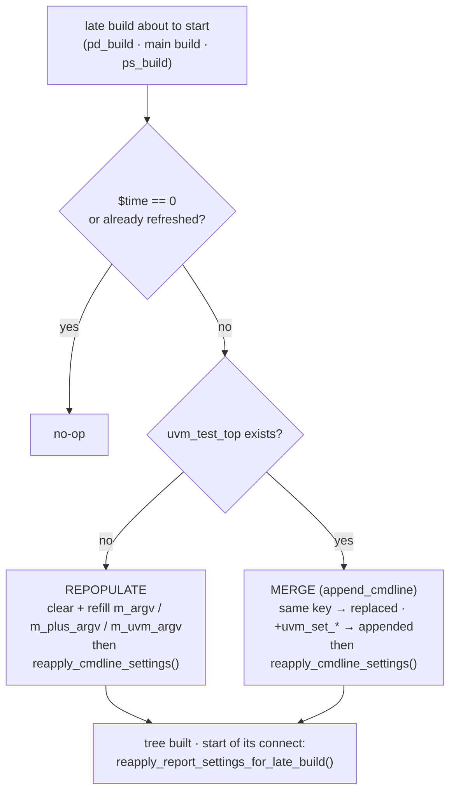

<div align="center">

# nv_socv_sim_restore

### Dynamic UVM topology for SoC save / restore

**Static RTL does not need a static UVM tree.**
Build each part of the testbench when it is needed — after boot, after a
checkpoint restore, or in the middle of the main test — with the command line
of *that* invocation.


[Overview](#-overview) ·
[Topology over time](#-topology-over-time) ·
[Approach A](#-approach-a--delayed-run_test) ·
[Pre domain](#-approach-b--pre-domain) ·
[Post domain](#-approach-b--post-domain) ·
[Command line](#-command-line-reprocessing) ·
[Save / restore](#-save--restore) ·
[Quick start](#-quick-start-vcs--xcelium) ·
[Reference](#-reference)

</div>

---

## ◆ Overview

Standard UVM has **one topology, created at time 0**: one `uvm_test_top`, built
in the common domain at time 0, port bindings resolved once at
`end_of_elaboration`, the command line parsed once. A checkpoint taken after
boot therefore freezes the *test* as well as the design, and every restore
replays the test that was chosen before the save.

This package removes that limit. The UVM tree is created **at non-zero time,
in stages**, and each stage reprocesses the command line first:

| Stage | What is built | When | API |
|:--|:--|:--|:--|
| **Approach A** — delayed launch | the whole test (`uvm_test_top`) | after boot / restore, `run_test()` gated | `nv_socv_delayed_test_launch` |
| **Approach B** — pre domain | common boot tree `uvm_pre_top` | time 0, in its own domain `pre_dom` | `install_pre_domain()` · `pd_release_main()` |
| | main test `uvm_test_top` | at `release_main()` | |
| **Approach B** — post domain | post tree `uvm_post_top` | at `release_post()`, during the main test | `install_post_domain()` · `pd_release_post()` |
| All of the above | — | right before each late build | `nv_socv_cmdline_processor` |

Benefits:

- **One save, many restores** — save once after the long boot, restore into
  any test with a new command line (`+UVM_TESTNAME`, `+POST_TEST`,
  `+uvm_set_*`, test plusargs).
- **Simulation performance** — components that are not built yet have no
  threads, no sampling, no coverage and no memory.
- **Phased adoption** — existing tests keep working; the post domain lets new
  content join a running test without touching the main tree.

### Package contents

| File | Contents |
|:--|:--|
| [`src/nv_socv_sim_restore_pkg.sv`](src/nv_socv_sim_restore_pkg.sv) | `package nv_socv_sim_restore_pkg` (`timeunit 1fs`), includes everything below |
| [`src/nv_socv_cmdline_processor.sv`](src/nv_socv_cmdline_processor.sv) | command-line refresh / merge / reapply for late builds and restores |
| [`src/nv_socv_delayed_test_launch.sv`](src/nv_socv_delayed_test_launch.sv) | launch gate for `run_test()` and `nv_socv_config_db#(T)` |
| [`src/nv_socv_pre_domain.sv`](src/nv_socv_pre_domain.sv) | `pd_*` phases, `pre_domain_controller`, `install_pre_domain()` |
| [`src/nv_socv_post_domain.sv`](src/nv_socv_post_domain.sv) | `ps_*` phases, `post_domain_controller`, `install_post_domain()` |
| [`src/nv_socv_report_macros.sv`](src/nv_socv_report_macros.sv) | `` `nv_uvm_info/warning/fatal`` usable before `run_test()` |
| [`tests/`](tests/) | self-contained VCS / Xcelium tests for every flow |

---

## ◆ Topology over time

```
 sim time ──────────────────────────────────────────────────────────────────────────────▶
                                   ◆ A                          ◆ B
            0                      │ release_main()             │ release_post()
            │                      │                            │
 pre_dom    │ uvm_pre_top          │                            │
 (boot)     │  └ boot_env          │   pd_run keeps going (monitors, clocks, …) ───────────▶
            │     ├ clk_rst_agt    │                            │
            │     └ fw_load_agt    │                            │
            │                      │                            │
 uvm        │                      │ uvm_test_top               │
 (main)     │                      │  └ soc_env                 │   ─────────────────────▶
            │                      │     ├ cpu_agt  ├ ddr_agt   │
            │                      │     └ soc_sb               │
            │                      │                            │
 post_dom   │                      │                            │ uvm_post_top
 (post)     │                      │                            │  └ pcie_env ──────────▶
            │                      │                            │     ├ pcie_agt ├ pcie_sb
            │                      │                            │     └ pcie_cov
```

- **Save point A** — boot done, main test not built (`pd_gate`, or the
  Approach A launch gate). Restore into *any* main test.
- **Save point B** — main test running, post tree not built (before
  `release_post()`). Restore into *any* post test.
- Simulation time is **not reset** by a restore: `$time` continues from the
  save point, and every late build happens at that non-zero time.

---

## ◆ Approach A — delayed `run_test()`

Hold `run_test()` until the boot (pure SV / C, no UVM components) is done or a
checkpoint is restored. Pins are driven to legal idle values by module code
until the UVM tree takes over.



```systemverilog
module tb_top;
  import uvm_pkg::*;
  import nv_socv_sim_restore_pkg::*;

  initial begin : boot                       // pure SV, no UVM component
    ...reset, firmware load...
    nv_socv_delayed_test_launch::trigger_test_launch();
  end

  initial begin : launch
    nv_socv_delayed_test_launch::wait_for_test_launch_trigger();  // no-op without the plusarg
    run_test();
  end

  initial begin : module_cfg_reader          // module code that needs config_db
    bit found;
    nv_socv_config_db#(virtual my_if)::get(null, "", "my_if", vif, found);
  end
endmodule
```

| API | Purpose |
|:--|:--|
| `is_delayed_launch_active()` | `+NV_SOCV_DELAYED_TEST_LAUNCH` given? |
| `trigger_test_launch()` | open the gate (boot done / restore settled) |
| `wait_for_test_launch_trigger()` | `run_test()` side: suppress `RUNPHSTIME`, wait, refresh the command line |
| `wait_for_test_launch_gate()` | bare wait, for module / interface code |
| `nv_socv_config_db#(T, TIMEOUT)::get()` | `uvm_config_db#(T)::get()` that waits for the gate, then `wait_modified()` up to `TIMEOUT` on a miss (`NV_SOCV_CONFIG_DB_TIMEOUT` warning) |
| `nv_socv_config_db#(T)::set()` | pass-through to `uvm_config_db#(T)::set()` |

> **Re-home time-0 config.** Any `uvm_config_db::get()` in module code that
> used to run at time 0 must go through `nv_socv_config_db`, otherwise it runs
> before the test that publishes the value exists.

---

## ◆ Approach B — pre domain

The common boot lives in its own UVM domain `pre_dom` (`uvm_pre_top`, built at
time 0). The main test is built when the boot calls `release_main()`; the pre
tree keeps running alongside it until after the main test's `final`.



**Install, release, select the main test**

```systemverilog
// tb_top
initial begin
  pre_domain_controller ctl = install_pre_domain("boot_pre_test", "soc_test_a");
  ctl.gate_timeout_ns = 1_000_000;            // optional safety net
  run_test();                                 // no name: test chosen at the release
end

// anywhere (pre test, sequence, module, interface)
pre_domain_controller::release_main("boot done");   // or pd_release_main()
```

Main test, chosen at the main build *after* the command line is reprocessed:
`uvm_test_top` if `run_test()` already created it at time 0 → else
`+UVM_TESTNAME` → else the `main_test` argument of `install_pre_domain()`.

**Sync semantics**

| Situation | Behaviour |
|:--|:--|
| Pre runtime phases already done at T1 | not synced |
| Pre runtime phases not done at T1 | synced with the main phases of the same name; each synced phase ends only when **both** sides dropped their objections |
| Main jumps **forward** | skipped main phases are DONE; the pre side runs them alone and meets main at the target |
| Main jumps **backward** | the pre side ends its current phase and waits at the start of its next one until main is back there |

**Rules**

- Always-active `run_phase` loops in the pre tree must not hold objections.
- Do not wait for `release_main()` in the pre `build/connect/eoe/sos` — they
  run before the gate.
- Pre default sequences: `pd_run_phase` or a runtime phase, never `run_phase`
  (`PREDOM/PRE_DEFSEQ`).
- Domain-aware VIP that calls `set_domain()` in the pre tree is caught
  (`PREDOM/PRE_DOMAIN`); fix with `+PREDOM_ADOPT`, `+PREDOM_ADOPT_RETURN` or
  `+PREDOM_EXCLUDE`.

---

## ◆ Approach B — post domain

A post test in its own domain `post_dom` (`uvm_post_top`) joins the **running**
main test at `release_post()`. Its runtime phases are synced with the main
test's: catch-up first, lockstep after.



```systemverilog
// main env build_phase (or tb_top before run_test())
void'(install_post_domain("pcie_post_test"));                // +POST_TEST=<name> wins
void'(install_post_domain_by_type(my_env#(P1, P2)::get_type()));  // parameterized

// anywhere, typically the main test's main_phase
post_domain_controller::release_post("traffic ready");       // or pd_release_post()

// wait for it, from anywhere
bit started;
pd_wait_post_started(started);                               // started == 0: skipped
```

**What the post domain guarantees**

| Topic | Behaviour |
|:--|:--|
| Gate | `ps_gate` opens at `release_post()`; with no release the post domain is **skipped** at the end of the main runtime phases (`+POST_GATE_TIMEOUT=<ns>` turns that into a fatal) |
| Catch-up | post phases the main test has already finished run back to back |
| Lockstep | from the main test's current phase on, each runtime phase ends only when both sides dropped their objections |
| Jumps | mirrored after the sync: backward if the other side is past the target, forward if it is before it; retried for ~50 deltas while the other side is syncing, then `PSDOM/JUMP` warning. `+PSDOM_NO_JUMP_MIRROR` turns it off |
| Connects | a connect window is open from `ps_build` to the end of `ps_connect`; bindings are resolved with `uvm_post_top.do_resolve_bindings()` at `ps_eoe` |
| `ILLCRT` | UVM's "component created after build" fatal is caught for the post tree only |
| End | `ps_extract … ps_final` run before the main `extract … final` |

**Rules**

- Post default sequences: `ps_run_phase` or a runtime phase (`PSDOM/POST_DEFSEQ`).
- Main-tree ports connected to post-tree imps after the main `eoe` may not take
  effect; pass handles or use events / callbacks.
- Install up to the main `start_of_simulation` (later: `PSDOM/LATE`).

---

## ◆ Command-line reprocessing

UVM reads the command line **once**, at time 0. A tree built later — after a
restore with new plusargs — would otherwise see the *save* invocation's command
line. `nv_socv_cmdline_processor` rewrites the `uvm_cmdline_processor` tables
from the current invocation (`uvm_dpi_get_next_arg()`) right before each late
build.



| API | Called by | Effect |
|:--|:--|:--|
| `refresh_cmdline_parser_for_test_launch()` | Approach A gate | rebuild the argv tables; **fatal** if `uvm_test_top` already exists |
| `refresh_cmdline_parser_for_restore()` | save-context restore | merge the restore arguments + `reapply_cmdline_settings()` |
| `refresh_cmdline_for_late_build(who)` | pre / post controllers | picks one of the two above; no-op at time 0 or if already refreshed |
| `reapply_cmdline_settings()` | the refresh paths | global verbosity, `+uvm_set_action/severity/verbosity`, factory overrides, `+uvm_set_config_int/string`, default sequence, `+UVM_TIMEOUT`, `+UVM_MAX_QUIT_COUNT` |
| `reapply_report_settings_for_late_build(who)` | pre / post controllers, start of connect | report switches for components created *after* the refresh |
| `is_cmdline_refreshed()` | anyone | refreshed in this invocation? |

**Merge rules** (`+NAME=value`, key = text before the first `=`)

| Argument | Action | Report |
|:--|:--|:--|
| key already present | every entry with that key replaced | `NV_SOCV_CMDLINE_PROCESSOR/OVERRIDE` |
| `+uvm_set_action/severity/verbosity/inst_override/type_override/config_int/config_string/default_sequence` | always appended (independent settings) | — |
| new key / positional | appended | — |

> **Caveats.** Factory overrides affect objects created *after* the refresh.
> Config DB consumers must call `get()` again. The refresh touches
> `uvm_cmdline_processor` internals (`m_argv`, `m_plus_argv`, `m_uvm_argv`)
> and `uvm_root::m_check_verbosity()`; re-run [`tests/`](tests/) whenever the
> UVM version changes.

---

## ◆ Save / restore

| | Save run | Restore run |
|:--|:--|:--|
| **VCS** | `./simv <args> +sim_image_save_enable +sim_image_save_dir_path=<dir> +sim_image_save_file=<f> [+sim_finish_after_save]` → `$save` | `./simv -r <dir>/<f> +sim_image_restore_enable <new args>` |
| **Xcelium** | elaborate and run with `-64bit -process_save`: `xrun -64bit -R -process_save <args> +sim_image_save_enable +sim_image_save_file=<name> [+sim_finish_after_save]` → `$save("<name>")` | `xrun -64bit -r <name> +sim_image_restore_enable <new args>` |
| Approach A | `+NV_SOCV_DELAYED_TEST_LAUNCH` | `+UVM_TESTNAME=<test>` + test plusargs / `+uvm_set_*` |
| Pre domain (point A) | *no* `+UVM_TESTNAME` | `+UVM_TESTNAME=<main test>` + main plusargs |
| Post domain (point B) | `+UVM_TESTNAME=<main>` | `+POST_TEST=<post test>` + post plusargs |

- **`$time` is preserved.** The restored run continues at the save time; the
  pre/post builds happen at that time (`RUNPHSTIME` is suppressed for
  Approach A). Timeouts are absolute.
- **Choose the save point before any `+UVM_TESTNAME`-dependent object exists.**
  A test created before the save cannot be replaced by the restore.
- Module code and classes request a save with the global `uvm_event`
  `"sim_image_save"` and resume on `"sim_image_saved"` (see
  [`tests/common/sim_save_restore.sv`](tests/common/sim_save_restore.sv)).

---

## ◆ Quick start (VCS · Xcelium)

### Layout

```
nv_socv_sim_restore/
├── src/                         library (nv_socv_sim_restore_pkg)
└── tests/
    ├── common/
    │   ├── common.mk            VCS / Xcelium flow, sim_run / sim_save / sim_restore
    │   ├── sim_save_restore.sv  $save — VCS · Xcelium -process_save
    │   └── tests_common_pkg.sv  phase_logger · heartbeat · jump_once · save_point
    ├── delayed_launch/          Approach A
    ├── pre_domain/              Approach B — pre domain   (save point A)
    └── post_domain/             Approach B — post domain  (save point B)
```

Each test folder has `Makefile`, `files.f`, `tb_top.sv`, `test_pkg.sv`.
`make` (or `make help`) prints the targets. Logs go to `logs/<target>_<sim>.log`.

### VCS

**Approach A — delayed launch**

```bash
cd tests/delayed_launch
make compile                                   # vcs -ntb_opts uvm-1.2
make run_classic                               # no gate: test built at time 0
make run_delayed                               # +NV_SOCV_DELAYED_TEST_LAUNCH: test built at boot done
make save                                      # ◆ A: boot done, no UVM tree, then $finish
make restore TEST=dl_test_b DL_MODE=7 N_ITEMS=8
                                               # simv -r ckpt_vcs/dl_ckpt_a.chk +UVM_TESTNAME=dl_test_b
                                               #   +DL_MODE=7 +uvm_set_config_int=uvm_test_top.env.drv,n_items,8
make restore_a                                 # same checkpoint, dl_test_a
```

**Approach B — pre domain**

```bash
cd tests/pre_domain
make compile
make run_default                               # boot, then soc_test_a
make save                                      # ◆ A: boot done, gate closed, then $finish
make restore MAIN_TEST=soc_test_b MAIN_SEED=42 # simv -r ckpt_vcs/pre_ckpt_a.chk +UVM_TESTNAME=soc_test_b
```

**Approach B — post domain**

```bash
cd tests/post_domain
make compile
make run_default                               # release 30 ns into the main main_phase
make save                                      # ◆ B: before release_post(), then $finish
make restore POST_TEST=pcie_post_test_b POST_MAIN=50
```

**Options**

```bash
make compile UVM_VER=uvm-ieee-2020            # another VCS UVM library
make compile VCS_HOME=/path/to/vcs            # vcs not on PATH
```

### Xcelium

Same targets with `SIM=xrun`; compile once per test folder. Save/restore uses
Xcelium's process-based checkpoint: `-process_save` (with `-64bit`) on the
elaboration and the simulation, `$save("<name>")` at the save point, then
`xrun -r <name>` to restore and continue. A Tcl `save -simulation` does not
work here: it fails with `*E,SVNOCL` once SystemVerilog class objects (the
UVM tree) exist.

```bash
export XCELIUM_HOME=/path/to/XCELIUM<version>  # xrun = $XCELIUM_HOME/tools/bin/xrun
export UVM_HOME=CDNS-1.2                       # or a UVM source install
```

**Approach A — delayed launch**

```bash
cd tests/delayed_launch
make compile SIM=xrun                          # xrun -64bit -uvm -uvmhome $UVM_HOME -elaborate -process_save
make run_delayed SIM=xrun                      # xrun -64bit -R -process_save +NV_SOCV_DELAYED_TEST_LAUNCH
make save SIM=xrun                             # ◆ A: $save("dl_ckpt_a")
make restore SIM=xrun TEST=dl_test_b DL_MODE=7 # xrun -r dl_ckpt_a +UVM_TESTNAME=dl_test_b +DL_MODE=7 ...
```

**Approach B — pre domain**

```bash
cd tests/pre_domain
make compile SIM=xrun
make run_default SIM=xrun
make save SIM=xrun                             # ◆ A: $save("pre_ckpt_a")
make restore SIM=xrun MAIN_TEST=soc_test_b     # xrun -r pre_ckpt_a +UVM_TESTNAME=soc_test_b
```

**Approach B — post domain**

```bash
cd tests/post_domain
make compile SIM=xrun
make run_default SIM=xrun
make save SIM=xrun                             # ◆ B: $save("post_ckpt_b")
make restore SIM=xrun POST_TEST=pcie_post_test_b
```

> **Xcelium restore.** The flow relies on the restored run seeing its *new*
> plusargs (`$test$plusargs` and `uvm_dpi_get_next_arg()`). Check
> `NV_SOCV_CMDLINE_PROCESSOR/*` and `PSDOM/GATE` / `PREDOM/GATE` in
> `logs/restore_*_xrun.log` the first time you use a new Xcelium version.

### Common variables

| Variable | Default | Meaning |
|:--|:--|:--|
| `SIM` | `vcs` | `vcs` or `xrun` |
| `UVM_VER` | `uvm-1.2` | VCS `-ntb_opts` UVM library |
| `VCS_HOME` | — | optional; `vcs` from `PATH` when unset |
| `XCELIUM_HOME` / `XRUN` | — | Xcelium install / explicit `xrun` path |
| `UVM_HOME` | — | Xcelium `-uvmhome` |
| `VERBOSITY` | `UVM_MEDIUM` | `+UVM_VERBOSITY` |
| `ARGS` | — | extra plusargs on every run |
| `CKPT_NAME` | per test | VCS `ckpt_vcs/<name>.chk` · Xcelium checkpoint `<name>` (`xrun -r <name>`) |
| `SAVE_FINISH` | `1` | `+sim_finish_after_save` on `make save` |
| `VCS_EXTRA` / `XRUN_EXTRA` | — | extra compile options |

### Targets

<details open>
<summary><b>tests/delayed_launch</b> — Approach A</summary>

| Target | What it shows |
|:--|:--|
| `run_classic` | no gate: `dl_test_a` built at time 0, boot in parallel |
| `run_delayed` | gate: boot in SV, `dl_test_a` built at boot done |
| `run_delayed_b` | same with `+UVM_TESTNAME=dl_test_b` (adds `env.chk`) |
| `save` | ◆ A: boot done, no UVM tree, `$finish` |
| `restore` | `TEST=dl_test_b DL_MODE=7 N_ITEMS=8`: new test, new plusarg, `+uvm_set_config_int` |
| `restore_a` | restore with `dl_test_a` |

</details>

<details open>
<summary><b>tests/pre_domain</b> — Approach B, pre domain</summary>

| Target | What it shows |
|:--|:--|
| `run_default` | boot 40 ns, then `soc_test_a` (install default) |
| `run_cmdline` | main test from `+UVM_TESTNAME=soc_test_b` |
| `run_pre_long` | `fw_load_agt` main 300 ns: the main `main_phase` waits (synced) |
| `run_jump_back` | main jumps main → reset; pre waits at the start of `post_main` |
| `run_jump_fwd` | main jumps main → shutdown; pre runs the skipped phases alone |
| `run_gate_timeout` | no release: `PREDOM/GATE` fatal at 500 ns |
| `save` | ◆ A: boot done, gate closed, `$finish` |
| `restore` | `MAIN_TEST=soc_test_b MAIN_SEED=42` |
| `restore_a` | restore with `soc_test_a` |

</details>

<details open>
<summary><b>tests/post_domain</b> — Approach B, post domain</summary>

| Target | What it shows |
|:--|:--|
| `run_default` | release 30 ns into the main `main_phase` |
| `run_release_reset` | release in reset: less catch-up, then lockstep |
| `run_release_late` | release 90 ns into main: main waits for post reset … main |
| `run_post_long` | post main 300 ns: main `main_phase` waits |
| `run_post_b` | `+POST_TEST=pcie_post_test_b` (adds `pcie_cov`) |
| `run_tb_release` | released from `tb_top` (module code) at 50 ns |
| `run_norelease` | never released: post domain skipped |
| `run_gate_timeout` | never released + `+POST_GATE_TIMEOUT=60`: fatal |
| `run_jump_main_back` / `run_jump_main_fwd` | main jump, mirrored on post |
| `run_jump_post_back` | post jump, mirrored on main |
| `run_jump_nomirror` | `+PSDOM_NO_JUMP_MIRROR` |
| `save` | ◆ B: before `release_post()`, `$finish` |
| `restore` | `POST_TEST=pcie_post_test_b POST_MAIN=50` |
| `restore_a` | restore with `pcie_post_test` |

</details>

---

## ◆ Reference

### Library plusargs

| Plusarg | Owner | Meaning |
|:--|:--|:--|
| `+NV_SOCV_DELAYED_TEST_LAUNCH` | Approach A | gate `run_test()` until `trigger_test_launch()` |
| `+UVM_TESTNAME=<name>` | pre domain | main test at the release (read after the refresh) |
| `+PREDOM_ADOPT=<glob,…>` | pre domain | keep domain-aware VIP in `pre_dom` |
| `+PREDOM_ADOPT_RETURN=<glob,…>` | pre domain | build in `pre_dom`, back to its own domain at the release |
| `+PREDOM_EXCLUDE=<glob,…>` | pre domain | make matching pre-tree components inert |
| `+PREDOM_NO_FOREIGN_CB_FILTER` | pre domain | do not hide foreign phase callbacks (UVM-ML) |
| `+POST_TEST=<name>` | post domain | post test (read again at `ps_build`) |
| `+POST_GATE_TIMEOUT=<ns>` | post domain | fatal if not released within `<ns>` |
| `+PSDOM_NO_JUMP_MIRROR` | post domain | do not mirror runtime phase jumps |
| `+PSDOM_NO_CONNECT_WINDOW` | post domain | do not open the post connect window |
| `+PSDOM_NO_FOREIGN_CB_FILTER` | post domain | do not hide foreign phase callbacks (UVM-ML) |

### Message IDs

| ID | Severity | Meaning |
|:--|:--|:--|
| `NV_SOCV_CMDLINE_PROCESSOR/REPOPULATE` · `/APPEND` · `/OVERRIDE` · `/REAPPLY` · `/LATE_BUILD` | info | what the refresh did and which arguments changed |
| `NV_SOCV_CMDLINE_PROCESSOR` | fatal | refresh for test launch after `uvm_test_top` exists |
| `NV_SOCV_CONFIG_DB_TIMEOUT` | warning | `nv_socv_config_db::get()` miss after `TIMEOUT` |
| `PREDOM/GATE` | info / fatal | main released · gate timeout |
| `PREDOM/PRE_DOMAIN` | error + fatal | a pre-tree component left `pre_dom` |
| `PREDOM/PRE_DEFSEQ` | error | `run_phase` default sequence in the pre tree |
| `PREDOM/NOTEST` · `/INVTST` | fatal | no main test · unknown test type |
| `PREDOM/ADOPTED` · `/RETURNED` · `/EXCLUDED` | info | adoption / exclusion applied |
| `PSDOM/GATE` | info / warning / fatal | released · gate timeout |
| `PSDOM/SKIP` | info | no release before the main runtime phases ended |
| `PSDOM/SYNC` | info / fatal | runtime phase sync |
| `PSDOM/JUMP` | info / warning | jump mirrored · not mirrored |
| `PSDOM/CONNECT` | info | connect window opened / closed |
| `PSDOM/ILLCRT` | info | `ILLCRT` suppressed for the post tree |
| `PSDOM/POST_DOMAIN` · `/POST_DEFSEQ` | error / fatal | post-tree domain / default-sequence checks |
| `PSDOM/LATE` · `/REINSTALL` · `/INVTST` | fatal / warning | install too late · second install · unknown test |

### FAQ

<details>
<summary><b>Why can't plain UVM do this?</b></summary>

UVM assumes a single topology: one `uvm_test_top`; `build` in the common
domain at time 0 (`ILLCRT` for anything created later); bindings resolved once
at `end_of_elaboration`; `config_db` precedence only during build; the command
line parsed once; global singletons. Domains only separate the *runtime*
phases. The pre/post domains add their own `build … final` nodes, so a second
tree gets a full, independent elaboration at any time.

</details>

<details>
<summary><b>Does the restored run start at time 0?</b></summary>

No. `$time` continues from the save point and late builds run at that time.
The Approach A gate suppresses `RUNPHSTIME` so `run_test()` may start late;
the pre domain replaces the root's own `run_phase` with a no-op for the same
reason.

</details>

<details>
<summary><b>Which command-line arguments take effect after a restore?</b></summary>

Everything read *after* the refresh: `+UVM_TESTNAME`, `+POST_TEST`, test
plusargs read in `build_phase` or later, and the `+uvm_set_*`, `+UVM_TIMEOUT`,
`+UVM_MAX_QUIT_COUNT`, verbosity switches reapplied by
`reapply_cmdline_settings()`. Values already consumed by objects that existed
before the save keep their saved state.

</details>

<details>
<summary><b>Can the main test reset and rerun the boot?</b></summary>

A main-test phase jump does not re-run the pre domain's `pd_*` phases; the pre
runtime phases follow the jump rules in the
[pre domain](#-approach-b--pre-domain) table. A reboot must be driven by the
pre tree itself (for example a boot task that can be re-entered on request).

</details>
