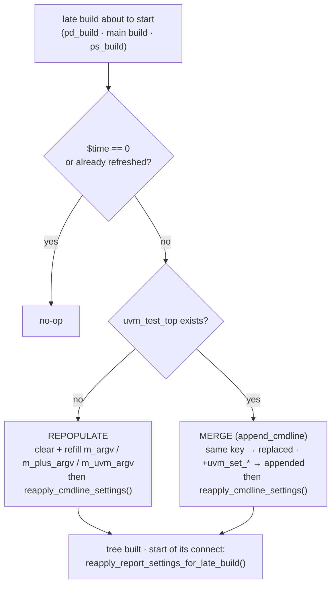

# Command-line reprocessing

UVM reads the command line **once**, at time 0. A tree built later — after a
restore with new plusargs — would otherwise see the *save* invocation's command
line. `nv_socv_cmdline_processor` rewrites the `uvm_cmdline_processor` tables
from the current invocation (`uvm_dpi_get_next_arg()`) right before each late
build.



| API | Called by | Effect |
|:--|:--|:--|
| `refresh_cmdline_parser_for_test_launch()` | Approach A gate | rebuild the argv tables; **fatal** if `uvm_test_top` already exists |
| `refresh_cmdline_parser_for_restore()` | save-context restore | merge the restore arguments + `reapply_cmdline_settings()` |
| `refresh_cmdline_for_late_build(who)` | pre / post controllers | picks one of the two above; no-op at time 0 or if already refreshed |
| `reapply_cmdline_settings()` | the refresh paths | global verbosity, `+uvm_set_action/severity/verbosity`, factory overrides, `+uvm_set_config_int/string`, default sequence, `+UVM_TIMEOUT`, `+UVM_MAX_QUIT_COUNT` |
| `reapply_report_settings_for_late_build(who)` | pre / post controllers, start of connect | report switches for components created *after* the refresh |
| `apply_build_settings_for_early_build(who)` | pre controller, start of `pd_build` | time 0 only: factory overrides + `+uvm_set_config_*` / default sequence before `uvm_root::build_phase` |
| `enter_build_config_precedence()` / `exit_build_config_precedence(prev)` | `pd_build` / `ps_build` around each `build_phase()` | standard build-phase config precedence (higher level wins) |
| `is_cmdline_refreshed()` | anyone | refreshed in this invocation? |

**Merge rules** (`+NAME=value`, key = text before the first `=`)

| Argument | Action | Report |
|:--|:--|:--|
| key already present | every entry with that key replaced | `NV_SOCV_CMDLINE_PROCESSOR/OVERRIDE` |
| `+uvm_set_action/severity/verbosity/inst_override/type_override/config_int/config_string/default_sequence` | always appended (independent settings) | — |
| new key / positional | appended | — |

> **Caveats.** Factory overrides affect objects created *after* the refresh.
> Config DB consumers must call `get()` again. The refresh touches
> `uvm_cmdline_processor` internals (`m_argv`, `m_plus_argv`, `m_uvm_argv`)
> and `uvm_root::m_check_verbosity()`; re-run [`tests/`](../tests/) whenever the
> UVM version changes.

## Worked cases — factory overrides and config at non-zero time

Every example has `*_cl` targets that change factory overrides and config on
the command line, where the tree using them is built at non-zero time. Each
target passes the expected results as `+EXP_<KEY>=<value>`, and the test checks them
(`tests_common_pkg::cl_expect`). Look for these lines in the log:

```text
UVM_INFO  ... [CL_EXPECT] DRV_TYPE = pcie_driver_fast as expected (post tree, type override) @...
UVM_ERROR ... [CL_EXPECT] PCIE_MAIN = 20, expected 77 (post tree, config_int vs env default) @...
UVM_INFO  ... [CL_EXPECT] 6 expectation(s) checked, 1 failed
```

The pattern is the same in all three examples. A **save run** gets *stale*
settings, and the **restore run** gets *new* ones. The `restore_cl_drop` and
`restore_cl_keep` targets show what happens when the restore gives none.

| Example | Target | Command-line settings | Expected |
|:--|:--|:--|:--|
| `delayed_launch` | `run_cl` | `+UVM_TESTNAME=dl_test_b`, type `dl_driver→dl_driver_fast`, inst `uvm_test_top.env.chk→dl_checker_strict`, `env.drv n_items=12` (env default 4), `env profile=stress` | all 4 applied |
| | `save_cl` | saved at the gate; stale: type `dl_driver→dl_driver_slow`, `n_items=2`, `profile=stale` | — |
| | `restore_cl` | the `run_cl` settings | all 4 applied, stale ones gone (**repopulate**: no `uvm_test_top` yet) |
| | `restore_cl_drop` | only `+UVM_TESTNAME=dl_test_b` | `dl_driver`, `dl_checker`, 4, `default` |
| `pre_domain` | `run_cl_pre` | type `fw_load_agent→fw_load_agent_fast`, `uvm_pre_top.env.fw_load_agt main_delay=90` (no save) | fast, 90 |
| | `run_cl_main` | `+UVM_TESTNAME=soc_test_b`, type `cpu_agent→cpu_agent_fast`, inst `uvm_test_top.env.ddr_agt→ddr_agent_lp`, `cpu_agt main_delay=250` (env sets 200), `profile=perf` | all 4 applied |
| | `save_cl` | saved before the main build; stale: `cpu_agent→cpu_agent_slow`, `main_delay=5`, `profile=stale` | — |
| | `restore_cl` | the `run_cl_main` settings | all 4 applied, stale ones gone (repopulate) |
| | `restore_cl_drop` | only `+UVM_TESTNAME=soc_test_b` | `cpu_agent`, `ddr_agent`, 200, `default` |
| `post_domain` | `run_cl` | `+POST_TEST=pcie_post_test_b`, type `pcie_driver→pcie_driver_fast`, inst `uvm_post_top.env.pcie_sb→pcie_scoreboard_strict`, `pcie_agt main_delay=77` (pcie env sets 20), `profile=gen5`; main tree: `uvm_test_top.env post_window=40` and type `soc_txn→soc_txn_ext`, both used by the main env **after the release** | all 6 applied |
| | `save_cl` | save point B (before the release); stale: `pcie_driver→pcie_driver_slow`, post `profile=stale`, `post_window=1` | — |
| | `restore_cl` | the `run_cl` settings | all 6 applied; each new setting wins over the stale one (**merge**: `uvm_test_top` exists, entries replayed in order) |
| | `restore_cl_keep` | none | stale ones persist: `pcie_driver_slow`, `pcie_scoreboard`, 20, `stale`, `post_window=1`, `soc_txn` |

```bash
cd tests/post_domain
make SIM=vcs compile
make SIM=vcs save_cl
make SIM=vcs restore_cl        # or restore_cl_keep
```

> **Two library behaviours these cases cover**
>
> 1. **Time-0 settings for the pre tree (`pre_domain run_cl_pre`: `FW_TYPE`,
>    `FW_MAIN`).** `pd_build` runs *before* `uvm_root::build_phase`, which is
>    where UVM applies `+uvm_set_*_override` / `+uvm_set_config_*`. At the start
>    of `pd_build` at time 0, the pre-domain controller calls
>    `nv_socv_cmdline_processor::apply_build_settings_for_early_build()`, which
>    applies them first. The root applies them again later with the same values.
> 2. **Config precedence in late builds (`PCIE_MAIN` in `post_domain`, `FW_MAIN`
>    in `pre_domain`).** `uvm_config_db::set` lowers precedence by context depth
>    (so the command line and the test win over a component's own default) only
>    while `uvm_root::m_current_phase` is named `build`. In `pd_build` and
>    `ps_build` that would not hold, and the latest set would win: the env's
>    `main_delay=20` would beat the command line's 77. Each `build_phase()` call
>    in `pd_build` and `ps_build` is therefore wrapped in
>    `enter_build_config_precedence()` / `exit_build_config_precedence()`. These
>    point `m_current_phase` at the common `build` node for that call, giving the
>    same precedence as a normal build.

