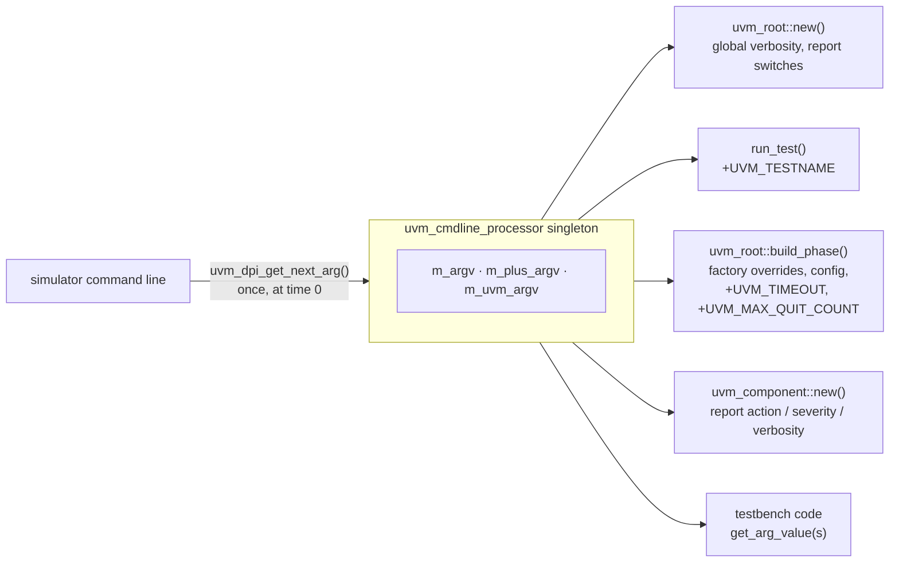
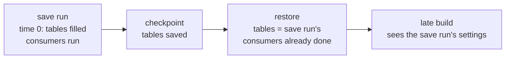
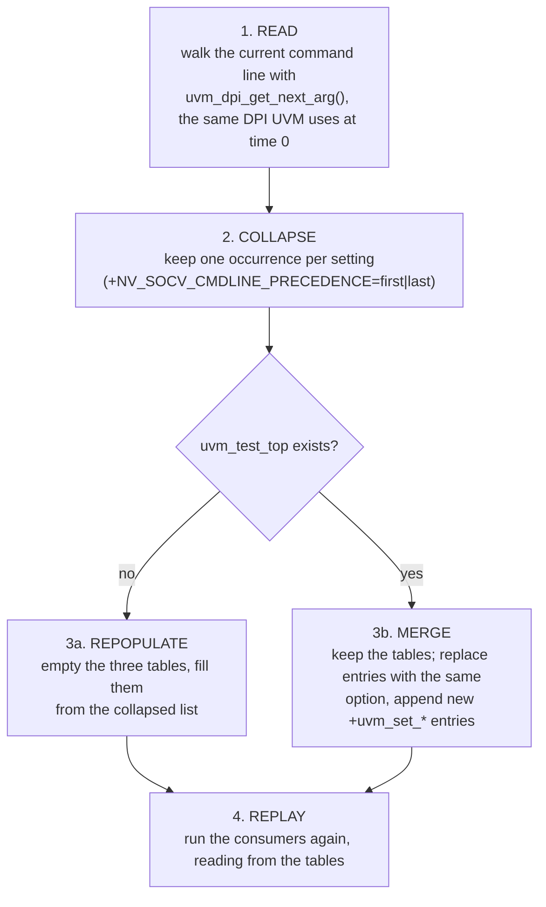
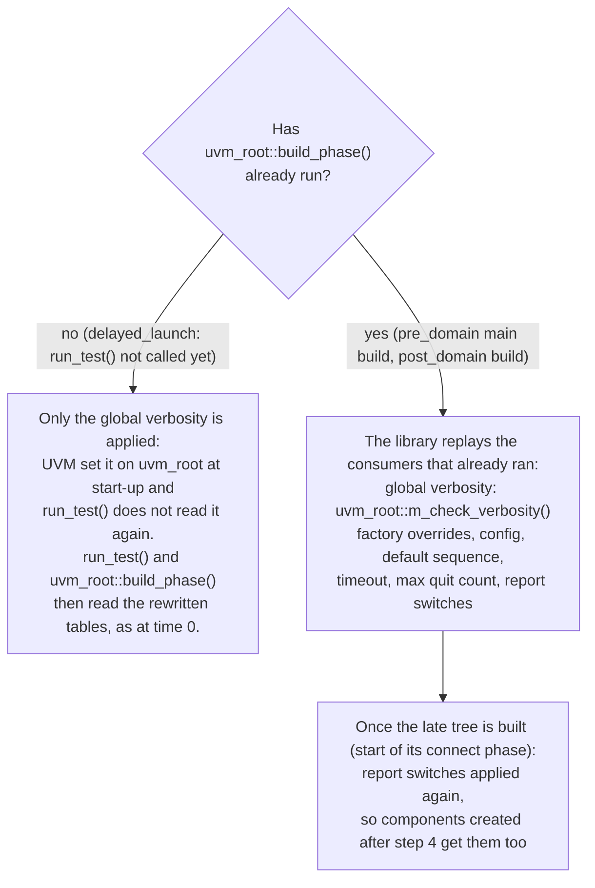

# Command-line reprocessing: the machinery

This page explains **how** the library gives a late-built UVM tree the
current command line: where UVM keeps the command line, how the library
reads it again and rewrites it, and which parts of UVM are reused
unchanged.

The **why**, the two strategies (repopulate and merge), the precedence of
repeated arguments, and the VCS vs Xcelium results are in
[cmdline_strategy.md](cmdline_strategy.md).

## How UVM handles the command line

UVM has one command-line object, the `uvm_cmdline_processor` singleton.
When it is created at time 0, it walks the simulator's command line through
a DPI call (`uvm_dpi_get_next_arg()`) and stores it in three string tables:

| Table | Holds |
|:--|:--|
| `m_argv` | every argument |
| `m_plus_argv` | the `+` arguments |
| `m_uvm_argv` | the `+UVM…` / `-UVM…` arguments |

After that, **nothing in UVM reads the simulator's command line again.**
Every consumer asks the singleton (`get_arg_values()`, `get_arg_matches()`,
`get_arg_value()`), and the singleton answers from its tables. The tables
are the single source of truth.

Each consumer reads the tables **at one fixed moment** and turns the text
into live state: factory overrides, `config_db` entries, report settings,
the timeout. For a normal run that is all at time 0, or in the first build.

## What goes wrong after a restore

A checkpoint stores the tables along with everything else. On restore:

1. The tables come back holding the **save** run's command line.
2. Most consumers have already run before the save, so they do not read the
   tables again.

A tree built after the restore therefore sees the save run's settings, and
the restore's new options are ignored.

## The approach: rewrite the tables, then reuse UVM

The library does not add a second command-line store. It fixes the one UVM
already has, so everything that reads it gets the new values for free.

`nv_socv_cmdline_processor` extends `uvm_cmdline_processor`. That is the only
reason for the class: as a subclass it may write the protected tables of the
real singleton. Its functions are static and work on that singleton; no
second instance is created.

Right before a late build, four steps run:

Steps 1 to 3 only change text in the tables. Step 4 turns the new text into
live UVM state.

### Step 4: replay, reusing what UVM already has

What needs replaying depends on which consumers have already run:

The replay functions follow UVM's own code (`uvm_root::m_do_factory_settings()`,
`m_do_config_settings()`, `m_do_timeout_settings()`, `m_do_max_quit_settings()`).
They get their input the same way UVM does, by asking the singleton
(`get_arg_matches()`, `get_arg_values()`), and apply it with the normal UVM
calls (`factory.set_*_override_by_name()`, `uvm_config_db::set()`,
`set_report_*()`, `set_timeout()`, `set_max_quit_count()`). The library does
not keep a copy of the settings; it reads the rewritten tables every time.

### What is reused and what is added

| Part | Reused from UVM | Added by the library |
|:--|:--|:--|
| Command-line source | `uvm_dpi_get_next_arg()` | read it again at T != 0 |
| Storage | the singleton's three tables | rewrite them (repopulate or merge) |
| Queries | `get_arg_values()`, `get_arg_matches()`, `get_arg_value()` | — |
| Test selection, first build | `run_test()`, `uvm_root::build_phase()` (delayed launch) | — |
| Applying settings | factory, `config_db`, report and timeout APIs | call them again when the first build is already over |
| Testbench code | its own `get_arg_value(s)` calls | — (it sees the new values if it reads after the rewrite) |

## Where it runs

| Flow | Point | Tables | Replay |
|:--|:--|:--|:--|
| `delayed_launch` | `trigger_test_launch`, before `run_test()` | repopulate | by UVM itself (`run_test()`) |
| `pre_domain` | `release_main()`, before the main-test build | repopulate | by the library |
| `post_domain` | `release_post()`, before the post-domain build | merge | by the library |

The reprocessing runs once per invocation. At time 0 it does nothing, since
the tables are already current.

## API

| API | Called by | Does |
|:--|:--|:--|
| `refresh_cmdline_parser_for_test_launch()` | delayed launch gate | steps 1 to 3 (repopulate) and the global verbosity; fatal if `uvm_test_top` exists |
| `refresh_cmdline_parser_for_restore()` | save-context restore | steps 1 to 3 (merge) and step 4 |
| `refresh_cmdline_for_late_build(who)` | pre / post domain controllers | picks repopulate or merge, then step 4; no-op at time 0 or if already done |
| `reapply_cmdline_settings()` | the refresh paths | step 4 |
| `reapply_report_settings_for_late_build(who)` | pre / post controllers, start of connect | report switches for components created after step 4 |
| `is_cmdline_refreshed()` | anyone | has the command line been reprocessed in this invocation? |
| `apply_build_settings_for_early_build(who)` | pre controller, start of `pd_build` | see below |
| `enter_build_config_precedence()` / `exit_build_config_precedence(prev)` | around each `build_phase()` in `pd_build` / `ps_build` | see below |

## Two related build fixes

These are not about restore, but they make command-line settings behave the
same for trees built outside the normal UVM build.

- **Pre tree at time 0.** `pd_build` runs before `uvm_root::build_phase()`,
  which is where UVM applies factory and config settings. The pre-domain
  controller calls `apply_build_settings_for_early_build()` first, so the pre
  tree sees them. UVM applies the same values again later.
- **Config precedence in `pd_build` and `ps_build`.** `uvm_config_db` lets a
  higher-level set (the command line, the test) beat a component's own
  default only while UVM's current phase is `build`. Each `build_phase()` call
  in those domains is wrapped in `enter_build_config_precedence()` /
  `exit_build_config_precedence()`, which point the current phase at the
  common `build` node for the duration of the call.

## Caveats

- Settings already used before the save keep their old values. A factory
  override affects objects created after step 4, and a `config_db` value
  changes only for code that calls `get()` again.
- The library writes UVM internals (`m_argv`, `m_plus_argv`, `m_uvm_argv`)
  and calls `uvm_root::m_check_verbosity()`. Rerun [`tests/`](../tests/) when
  the UVM version changes.

## Where it is checked

Each test folder has `*_cl` targets that give stale settings to the save run
and new ones to the restore, and check the result with `+EXP_<KEY>=<value>`
(`[CL_EXPECT]` lines in the log). `restore_cl_drop` and `restore_cl_keep`
give the restore no settings. The targets and their expected values are in
[tests.md](tests.md#command-line-targets).
