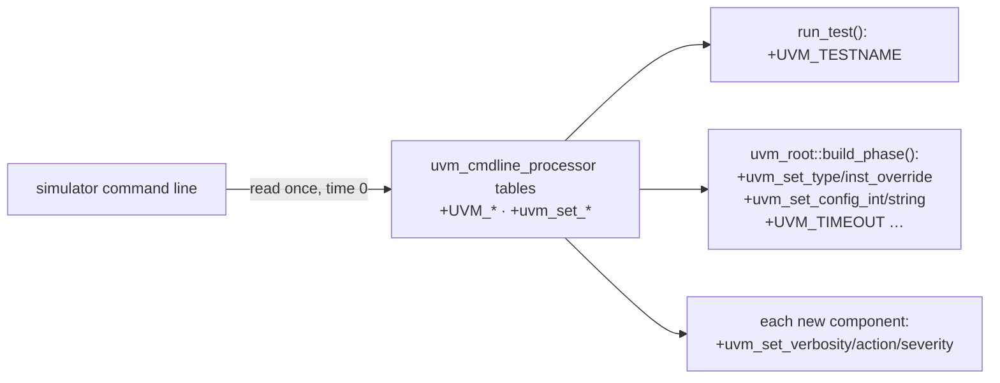
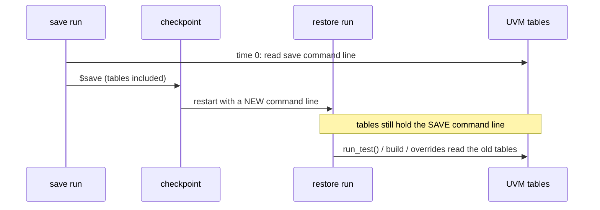
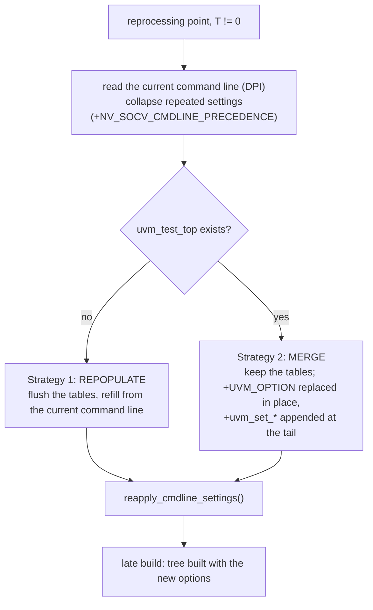
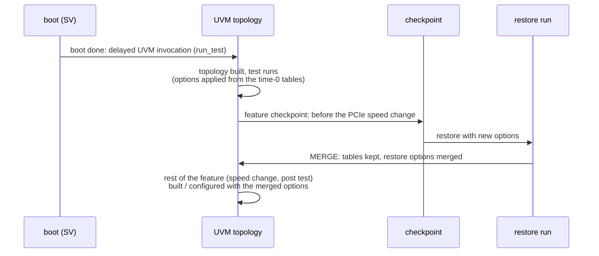
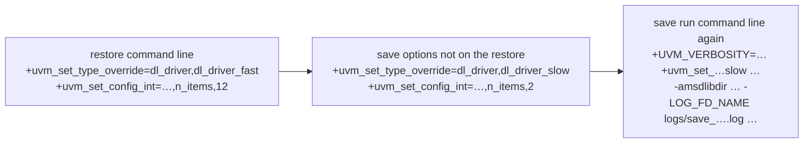

# UVM command-line reprocessing: strategy

How `nv_socv_cmdline_processor` makes UVM command-line options work when the
UVM test is built late, or after a restore. The API reference and the worked
test cases are in [cmdline_reprocessing.md](cmdline_reprocessing.md).

## The problem: UVM reads the command line once, at time 0

The `uvm_cmdline_processor` singleton reads the simulator command line once,
when UVM is first used at time 0, into its argument tables. This page is
about the UVM options in them: `+UVM_<OPTION>=<value>` (such as
`+UVM_TESTNAME`, `+UVM_VERBOSITY`, `+UVM_TIMEOUT`) and the `+uvm_set_*`
settings. Everything UVM does with them later (`+UVM_TESTNAME` in
`run_test()`, factory overrides and `config_db` settings in
`uvm_root::build_phase()`, report settings for each new component) reads
these tables, never the simulator again.



That gives two limitations:

1. **Delayed UVM invocation.** The UVM test is built at a non-zero time, for
   example after a boot done in plain SystemVerilog. The options it needs
   are applied from what the tables held at time 0, and the tables were
   saved with the boot.
2. **Restore with a new command line.** A checkpoint restores the tables as
   they were at the save. The options the user gives to the restore never
   reach them, so the code after the restore runs with the save run's
   options.



## The solution: reprocess the tables at T != 0

Right before the part of the testbench built after the restore (or after
the delay), the library reads the current command line again through
`uvm_dpi_get_next_arg()`, rewrites the tables, and reapplies the UVM
settings (`reapply_cmdline_settings()`). Components created after that
point also get the report settings
(`reapply_report_settings_for_late_build()`).

| Flow | Reprocessing point |
|:--|:--|
| Delayed UVM invocation, `delayed_launch` | the test launch after the boot (`trigger_test_launch()`) |
| Delayed UVM invocation, `delayed_launch` restored from feature checkpoint C | right after C, before the common sequence is created (`refresh_cmdline_parser_for_restore()`) |
| Domain-based proposal, `pre_domain` | `release_main()`: right before the main test is built |
| Domain-based proposal, `post_domain` | `release_post()`: right before the post test is built |

It happens once per run, never at time 0 (at time 0 the tables are already
current). Between the restore and the reprocessing point, the tables still
hold the save run's values.

The library picks one of two strategies, depending on whether the UVM
topology already exists:



## Strategy 1: repopulate (no `uvm_test_top` yet)

Used when nothing of the UVM test exists yet: `delayed_launch` and
`pre_domain`. Nothing has been built from the save run's UVM options, so
they carry no meaning. The tables are flushed and refilled from the current
command line only.

```mermaid
flowchart LR
    subgraph before ["tables before (save run, time 0)"]
        b1["+UVM_VERBOSITY=UVM_MEDIUM"]
        b2["+uvm_set_type_override=dl_driver,dl_driver_slow"]
        b3["+uvm_set_config_int=uvm_test_top.env.drv,n_items,2"]
        b4["+uvm_set_config_string=uvm_test_top.env,profile,stale"]
    end
    subgraph after ["tables after repopulate (restore command line)"]
        a1["+UVM_VERBOSITY=UVM_MEDIUM"]
        a2["+UVM_TESTNAME=dl_test_b"]
        a3["+uvm_set_type_override=dl_driver,dl_driver_fast"]
        a4["+uvm_set_inst_override=dl_checker,dl_checker_strict,uvm_test_top.env.chk"]
        a5["+uvm_set_config_int=uvm_test_top.env.drv,n_items,12"]
        a6["+uvm_set_config_string=uvm_test_top.env,profile,stress"]
    end
    before -- "flush + refill" --> after
```



Example (`tests/delayed_launch`):

```bash
make save_cl      # save run:    +uvm_set_type_override=dl_driver,dl_driver_slow
                  #              +uvm_set_config_int=uvm_test_top.env.drv,n_items,2
                  #              +uvm_set_config_string=uvm_test_top.env,profile,stale
make restore_cl   # restore run: +UVM_TESTNAME=dl_test_b
                  #              +uvm_set_type_override=dl_driver,dl_driver_fast
                  #              +uvm_set_inst_override=dl_checker,dl_checker_strict,uvm_test_top.env.chk
                  #              +uvm_set_config_int=uvm_test_top.env.drv,n_items,12
                  #              +uvm_set_config_string=uvm_test_top.env,profile,stress
```

Result: `dl_test_b` is built after the restore with `dl_driver_fast`,
`dl_checker_strict`, `n_items` 12 and profile `stress`. `make
restore_cl_drop` restores the same checkpoint with no settings: on VCS the
test gets its defaults (`dl_driver`, `n_items` 4, profile `default`).

## Strategy 2: merge (`uvm_test_top` exists)

Used when a checkpoint is taken **after** the UVM topology was created. Its
options were applied to that topology at time 0, and its factory and
`config_db` state is part of the checkpoint, so the tables are kept and the
restore's options are merged into them:

| UVM option from the restore | Action in the tables |
|:--|:--|
| `+UVM_<OPTION>=<value>` (`+UVM_TESTNAME`, `+UVM_VERBOSITY`, `+UVM_TIMEOUT`, `+UVM_MAX_QUIT_COUNT`, …) | the entry with the same option **replaced in place** (reported as `NV_SOCV_CMDLINE_PROCESSOR/OVERRIDE`); appended at the tail if the save run did not have it |
| `+uvm_set_*` (type / inst override, config int / string, verbosity, action, severity, default sequence) | **appended at the tail**: these are independent settings; UVM applies them in table order, so for the same target the restore's, applied last, wins |

Typical flow, a feature checkpoint: boot, then the delayed UVM invocation
builds the topology, the test runs to an interesting point of a feature
(for example, right before a PCIe speed change), the checkpoint is taken
there, and each restore continues the feature with its own options.
`post_domain` is this case: the main test runs, the checkpoint is taken
before `release_post()`, and the post test is built after the restore.

```mermaid
flowchart LR
    subgraph before ["tables before (save run; +UVM_TIMEOUT added for illustration)"]
        b1["+UVM_TIMEOUT=1000000"]
        b2["+uvm_set_type_override=pcie_driver,pcie_driver_slow"]
        b3["+uvm_set_config_int=uvm_test_top.env,post_window,1"]
    end
    subgraph after ["tables after merge"]
        a1["+UVM_TIMEOUT=2000000 (replaced in place)"]
        a2["+uvm_set_type_override=pcie_driver,pcie_driver_slow"]
        a3["+uvm_set_config_int=uvm_test_top.env,post_window,1"]
        a5["+uvm_set_type_override=pcie_driver,pcie_driver_fast (appended, applied last)"]
        a6["+uvm_set_config_int=uvm_test_top.env,post_window,40 (appended, applied last)"]
    end
    before -- "merge" --> after
```





Example (`tests/post_domain`):

```bash
make save_cl          # feature checkpoint B, before release_post():
                      #   +uvm_set_type_override=pcie_driver,pcie_driver_slow
                      #   +uvm_set_config_string=uvm_post_top.env,profile,stale
                      #   +uvm_set_config_int=uvm_test_top.env,post_window,1
make restore_cl       # restore: +uvm_set_type_override=pcie_driver,pcie_driver_fast
                      #   +uvm_set_config_string=uvm_post_top.env,profile,gen5
                      #   +uvm_set_config_int=uvm_test_top.env,post_window,40 ...
make restore_cl_keep  # restore with no settings
```

Result: with `restore_cl` the post test gets `pcie_driver_fast` and
profile `gen5`, and the main env, which reads `post_window` again after the
release, gets 40. With `restore_cl_keep` the save run's settings stay in
effect (`pcie_driver_slow`, `stale`, `post_window` 1), since they are part
of the topology's state.

The same merge serves the feature checkpoint C of `tests/delayed_launch`:
`make save_c` saves C with `scenario,1`; `make restore_c` adds `scenario,3`
and `dl_scenario_seq→dl_scenario_seq_long`, which the common sequence created
after C picks up; `make restore_c_keep` keeps scenario 1.

A `+UVM_<OPTION>` replaced in place (illustration with `+UVM_TIMEOUT`):

```text
save run tables : ... +UVM_TIMEOUT=1000000 ...
restore         : +UVM_TIMEOUT=2000000
after merge     : ... +UVM_TIMEOUT=2000000 ...      (same position)
OVERRIDE report : Command-line argument overridden: '+UVM_TIMEOUT=1000000' -> '+UVM_TIMEOUT=2000000'
```

## Repeated arguments: precedence

Before either strategy, the current command line is collapsed so that each
setting appears once. A setting is identified by what it targets, not by
its value:

| Argument | Same setting when equal |
|:--|:--|
| `+uvm_set_type_override=<req>,<ovr>` | `<req>` |
| `+uvm_set_inst_override=<req>,<ovr>,<path>` | `<req>`, `<path>` |
| `+uvm_set_config_int` / `_string=<path>,<field>,<val>` | `<path>`, `<field>` |
| `+uvm_set_default_sequence=<path>,<phase>,<seq>` | `<path>`, `<phase>` |
| `+uvm_set_verbosity=<comp>,<id>,<verb>,<phase>[,<time>]` | all fields but `<verb>` |
| `+uvm_set_action` / `_severity=<comp>,<id>,<sev>,...` | `<comp>`, `<id>`, `<sev>` |
| `+UVM_<OPTION>=<value>` | `+UVM_<OPTION>` |

`+NV_SOCV_CMDLINE_PRECEDENCE` chooses which occurrence is kept:

| Value | Kept | Note |
|:--|:--|:--|
| `first` (default) | the first occurrence | |
| `last` | the last occurrence, at its position | |

```text
command line : +uvm_set_type_override=dl_driver,dl_driver_fast
               +uvm_set_type_override=dl_driver,dl_driver_slow
first        : +uvm_set_type_override=dl_driver,dl_driver_fast
last         : +uvm_set_type_override=dl_driver,dl_driver_slow
```

Different targets are independent and all kept, for example
`+uvm_set_type_override=dl_driver,dl_driver_fast` and
`+uvm_set_type_override=soc_txn,soc_txn_ext`.

### Xcelium: the restored command line

After an Xcelium restart (`-process_save`, `FLOW=std` and `FLOW=dtr`
alike), the command line reported through the DPI is not only the restore's.
It is the restore's command line, then the save run's options that are not
on it, then the save run's whole command line again (followed by its
internal `xmsim` options). VCS reports only the restore's command line.



With the default `first`, the restore's value wins for every setting it
gives, the same as on VCS. `last` makes the save run's value win.

Settings given **only** on the save run are still reported by Xcelium after
the restart, so on Xcelium they survive a repopulate (`restore_cl_drop` in
`delayed_launch` and `pre_domain` expects them on Xcelium, and the
defaults on VCS). To get the same result on both simulators, give a
checkpoint meant for many restores a minimal save command line: UVM cannot
unset a `+uvm_set_*` setting, only override its target.

## What is seen at each point, VCS and Xcelium

This section answers one question: **at a given moment, which value of a UVM
option (`+UVM_<OPTION>`, `+uvm_set_*`) does UVM use: the save run's or the
restore's?**

The life of a checkpoint has four moments:

1. **Save run.** UVM reads the save command line at time 0 and builds its
   tables from it.
2. **Checkpoint.** The tables are saved inside the checkpoint, with the save
   run's values.
3. **Restore, before the reprocessing point.** The tables come back from the
   checkpoint exactly as saved. UVM has not looked at the restore command
   line yet, so it still uses the save run's values.
4. **Reprocessing point** (`trigger_test_launch`, `release_main()`,
   `release_post()`). The library asks the simulator for the current command
   line and rewrites the tables (repopulate or merge). From here on, the
   result depends on whether the restore gave the option again.

The table uses the default, `+NV_SOCV_CMDLINE_PRECEDENCE=first`.

| Moment | VCS | Xcelium |
|:--|:--|:--|
| 1. Save run | save run's values | save run's values |
| 2. Checkpoint | save run's values are stored | same |
| 3. Restore, before reprocessing | still the **save run's** values | same |
| What the simulator reports as the command line after the restore | only the restore's command line | the restore's command line **and** the save run's arguments |
| 4. After reprocessing, the restore **gives the option again** (same option, same target) | the **restore's** value | the **restore's** value |
| 4. After reprocessing, the restore **does not give it**, repopulate | **gone**: UVM default | the **save run's** value (Xcelium still reports it, so it is read back in) |
| 4. After reprocessing, the restore **does not give it**, merge | the **save run's** value (merge keeps the old table) | the **save run's** value |
| Anything already used before the save: a variable already set, a `config_db::get()` already done, a component or object already created | keeps the **old** value; it changes only if it is read again or created after the reprocessing point | same |

#### Example

The save run has `+uvm_set_type_override=dl_driver,dl_driver_slow`. After
the reprocessing point:

| The restore command line has | Strategy | VCS builds | Xcelium builds |
|:--|:--|:--|:--|
| `+uvm_set_type_override=dl_driver,dl_driver_fast` | either | `dl_driver_fast` | `dl_driver_fast` |
| nothing for `dl_driver` | repopulate | `dl_driver` (no override) | `dl_driver_slow` |
| nothing for `dl_driver` | merge | `dl_driver_slow` | `dl_driver_slow` |

In short, a setting the restore gives again always wins. A setting the
restore leaves out survives merge on both simulators, and survives
repopulate only on Xcelium. `restore_cl_drop` (`delayed_launch`,
`pre_domain`) checks the repopulate row, and `restore_cl_keep`
(`post_domain`) checks the merge row.

With `+NV_SOCV_CMDLINE_PRECEDENCE=last`, only the "gives the option again"
row changes, and only on Xcelium. There, both copies are reported and the
save run's copy comes after the restore's, so `last` picks the save run's
value (`dl_driver_slow`). VCS reports only the restore's copy, so it still
gets `dl_driver_fast`.

## Verbosity on save and restore

There are two ways to set verbosity from the command line, and they behave
differently across a restore.

**Global: `+UVM_VERBOSITY=<verb>`.** UVM sets it once, when UVM starts, on
`uvm_root` and every component that exists. A component created later copies
its parent's level. `run_test()` does not read it again. The library
therefore applies it again itself at every reprocessing point:

| Moment | Level used |
|:--|:--|
| Save run, from time 0 | save run's value |
| Restore, before the reprocessing point | save run's value (restored with everything else) |
| At the reprocessing point | the restore's value, set on `uvm_root` and **every existing component**, including those restored from the checkpoint |
| Components created afterwards | the restore's value, copied from their parent |

The same holds on VCS and Xcelium, and in all three flows. In
`delayed_launch` it is applied right after the repopulate, before
`run_test()`. Xcelium's UVM also keeps a list of the global values parsed at
time 0, and uses its first entry. The library empties that list first, so
the restore's value is used and no `MULTVERB` warning is printed.

Things to know about the global option:

- **It overwrites levels set in code.** At the reprocessing point, every
  existing component's level is reset to the global value, including a
  component that set its own with `set_report_verbosity_level()`.
  Per-ID levels (`set_report_id_verbosity()`) are kept.
- **Restored code is affected too.** A tree that was running at the save
  changes level in the middle of its run, at the reprocessing point.
- **It is all or nothing.** It changes every component, so it cannot target
  only the part being debugged after the restore.

**Per component: `+uvm_set_verbosity=<comp>,<id>,<verb>,<phase>` or
`…,time,<time>`.**
It sets the level only for the components matching `<comp>`, and optionally
only for one message ID. The library applies it to matching components at
the reprocessing point, and again at the start of the late tree's connect
phase for components created after that point. It runs after the global
option, so it wins over it.

> [!TIP]
> **To change verbosity at restore, prefer `+uvm_set_verbosity` over
> `+UVM_VERBOSITY`.** Leave the global level as it was in the save run and
> raise only what you want to look at, for example:
>
> ```bash
> +uvm_set_verbosity=uvm_post_top.env.pcie_agt*,_ALL_,UVM_HIGH,time,0
> ```
>
> The restored trees keep their levels, and only the targeted components
> print more.

## Summary

| | Repopulate | Merge |
|:--|:--|:--|
| When | no `uvm_test_top` yet | `uvm_test_top` exists |
| Examples | `delayed_launch`, `pre_domain` | `post_domain`, feature checkpoints |
| Save run's tables | flushed | kept |
| Restore's `+UVM_<OPTION>` | the only entry | replaces the same option in place |
| Restore's `+uvm_set_*` | the only entries | appended at the tail, applied last |
| Save-run setting the restore does not give | gone on VCS; kept on Xcelium (still reported) | kept on both |
| Repeated settings on the current command line | collapsed by `+NV_SOCV_CMDLINE_PRECEDENCE` (default `first`) | same |
| After the rewrite | `reapply_cmdline_settings()`, then report settings for components created later | same |
