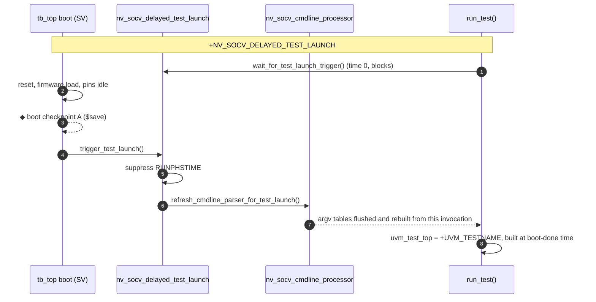
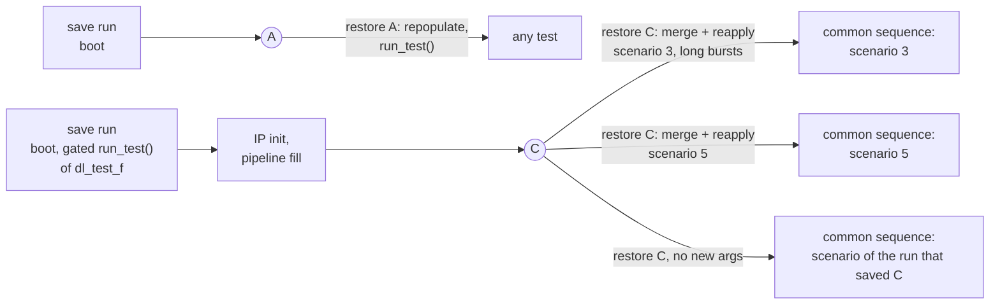

# Delayed UVM invocation

Hold `run_test()` until the boot (pure SV / C, no UVM components) is done or
the boot checkpoint is restored. Pins are driven to legal idle values by
module code until the UVM tree takes over. The boot checkpoint A then holds
the platform alone, and the restore's command line chooses the test.



```systemverilog
module tb_top;
  import uvm_pkg::*;
  import nv_socv_sim_restore_pkg::*;

  initial begin : boot                       // pure SV, no UVM component
    ...reset, firmware load...
    nv_socv_delayed_test_launch::trigger_test_launch();
  end

  initial begin : launch
    nv_socv_delayed_test_launch::wait_for_test_launch_trigger();  // no-op without the plusarg
    run_test();
  end

  initial begin : module_cfg_reader          // module code that needs config_db
    bit found;
    nv_socv_config_db#(virtual my_if)::get(null, "", "my_if", vif, found);
  end
endmodule
```

| API | Purpose |
|:--|:--|
| `is_delayed_launch_active()` | `+NV_SOCV_DELAYED_TEST_LAUNCH` given? |
| `trigger_test_launch()` | open the gate (boot done / restore settled) |
| `wait_for_test_launch_trigger()` | `run_test()` side: suppress `RUNPHSTIME`, wait, refresh the command line |
| `wait_for_test_launch_gate()` | bare wait, for module / interface code |
| `nv_socv_config_db#(T, TIMEOUT)::get()` | `uvm_config_db#(T)::get()` that waits for the gate, then `wait_modified()` up to `TIMEOUT` on a miss (`NV_SOCV_CONFIG_DB_TIMEOUT` warning) |
| `nv_socv_config_db#(T)::set()` | pass-through to `uvm_config_db#(T)::set()` |

> **Re-home time-0 config.** Any `uvm_config_db::get()` in module code that
> used to run at time 0 must go through `nv_socv_config_db`, otherwise it runs
> before the test that publishes the value exists.

## Feature checkpoint C

A feature checkpoint is taken later, inside the running test: after the
steps every scenario of the feature shares (IP initialization, pipeline
fill), before the scenario. The test already exists, so a restore from it
**merges** the restore's command line into the UVM tables and **reapplies**
the settings. A common sequence created after the checkpoint then reads the
scenario selector and the behaviour within the scenario from the restore's
UVM args. One checkpoint serves every scenario.

In `tests/delayed_launch` A and C are each saved by a run from scratch, so
both mechanisms are tested on their own: restores from A test delayed UVM
invocation with a **repopulated** command line; restores from C test the
**merge and reapply**. The run that saves C still uses delayed UVM
invocation (boot in SV, gated `run_test()`), but skips A
(`+DL_FEATURE_SAVE`):



```systemverilog
virtual task main_phase(uvm_phase phase);
  ...IP init and pipeline fill...
  save_point::take("C (feature: IP init and pipeline fill done)");
  if (save_point::restored_here())
    nv_socv_cmdline_processor::refresh_cmdline_parser_for_restore();  // merge + reapply
  seq = dl_scenario_seq::type_id::create("seq");   // created after C: sees the restore's settings
  seq.start(null);
endtask
```

In `tests/delayed_launch` (`dl_test_f`, `FLOW=std`):

| Target | Restores | Command line | Common sequence after C |
|:--|:--|:--|:--|
| `save` | — | boot checkpoint A | — |
| `save_c` | — (from scratch) | `+UVM_TESTNAME=dl_test_f`, scenario 1, `+DL_FEATURE_SAVE`; no A, saves C | — (the run ends at C) |
| `restore_c` | C (merge + reapply) | `+uvm_set_config_int=uvm_test_top.env,scenario,$(SCENARIO)`, `+uvm_set_type_override=dl_scenario_seq,dl_scenario_seq_long` | `dl_scenario_seq_long`, scenario `$(SCENARIO)` (3) |
| `restore_c_keep` | C (merge + reapply) | none | `dl_scenario_seq`, scenario 1 (kept by the merge) |
| `run_feature` | — (no save) | as `restore_c` | as `restore_c` |

Only objects created after the merge see the new factory and config
settings, so the sequence is created after C. Components built before C
keep the values they read; code that cached a value must call `get()` again.

