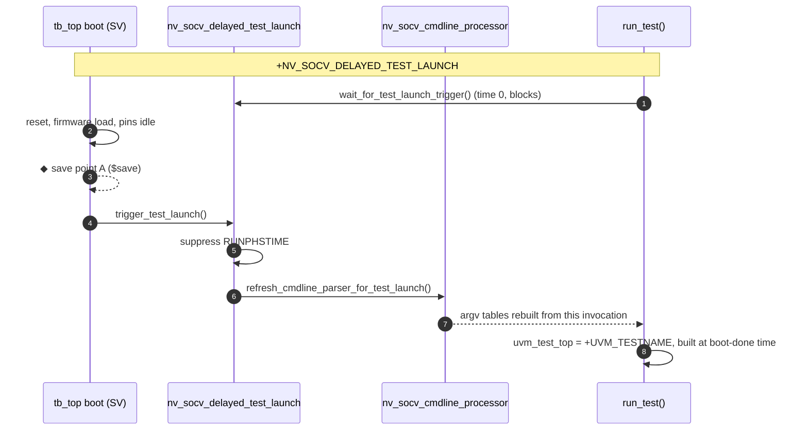

# Approach A — delayed `run_test()`

Hold `run_test()` until the boot (pure SV / C, no UVM components) is done or a
checkpoint is restored. Pins are driven to legal idle values by module code
until the UVM tree takes over.



```systemverilog
module tb_top;
  import uvm_pkg::*;
  import nv_socv_sim_restore_pkg::*;

  initial begin : boot                       // pure SV, no UVM component
    ...reset, firmware load...
    nv_socv_delayed_test_launch::trigger_test_launch();
  end

  initial begin : launch
    nv_socv_delayed_test_launch::wait_for_test_launch_trigger();  // no-op without the plusarg
    run_test();
  end

  initial begin : module_cfg_reader          // module code that needs config_db
    bit found;
    nv_socv_config_db#(virtual my_if)::get(null, "", "my_if", vif, found);
  end
endmodule
```

| API | Purpose |
|:--|:--|
| `is_delayed_launch_active()` | `+NV_SOCV_DELAYED_TEST_LAUNCH` given? |
| `trigger_test_launch()` | open the gate (boot done / restore settled) |
| `wait_for_test_launch_trigger()` | `run_test()` side: suppress `RUNPHSTIME`, wait, refresh the command line |
| `wait_for_test_launch_gate()` | bare wait, for module / interface code |
| `nv_socv_config_db#(T, TIMEOUT)::get()` | `uvm_config_db#(T)::get()` that waits for the gate, then `wait_modified()` up to `TIMEOUT` on a miss (`NV_SOCV_CONFIG_DB_TIMEOUT` warning) |
| `nv_socv_config_db#(T)::set()` | pass-through to `uvm_config_db#(T)::set()` |

> **Re-home time-0 config.** Any `uvm_config_db::get()` in module code that
> used to run at time 0 must go through `nv_socv_config_db`, otherwise it runs
> before the test that publishes the value exists.

