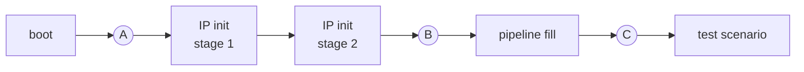

# Overview

Common initialization (boot) takes a large part of every SoC simulation, and
every feature test repeats it. A checkpoint taken after boot, or later in a
test (after an interface link is up, after its data pipeline is filled),
should remove that repetition. Native simulator save/restore, however, also
captures the UVM topology and the command line processed at time 0:

- a **boot checkpoint** is tied to the one test that produced it, because the
  test's tree was built at time 0 and is in the image;
- a **feature checkpoint** is tied to one scenario, because the UVM args that
  select the scenario were read at time 0 and are frozen in the image.

This package removes both limits:

1. **Delayed UVM invocation** (primary solution). Boot runs as SV / C code
   with no feature-test topology, and `run_test()` is called only after the
   restore, at non-zero time. The boot checkpoint holds the platform alone.
2. **Command-line reprocessing.** At restore, the UVM command-line tables are
   **repopulated** before the test exists (boot checkpoint) or **merged** and
   reapplied once it does (feature checkpoint), so one checkpoint serves
   many scenarios chosen by UVM args.
3. **Domain-based proposal** (fallback). Where boot cannot leave UVM, several
   topology trees are built, each when its stage begins: a boot tree in the
   pre domain, the main tree at the release, an optional post tree.

## Checkpoints



| Checkpoint | Taken | Shared by | Kind |
|:--|:--|:--|:--|
| **A** | after boot | every test | boot checkpoint |
| **B** | after IP initialization (for PCIe: link-up, speed change) | every scenario of the feature | feature checkpoint |
| **C** | after the pipeline fill | every scenario that uses the same fill | feature checkpoint |

Simulation time is **not reset** by a restore: `$time` continues from the
checkpoint, and every late build happens at that non-zero time.

## Solution space

| Option | What the image holds | Test topology comes from | Limitation or cost |
|:--|:--|:--|:--|
| 1. One checkpoint (chain) per test or scenario (today) | platform + UVM tree + command line | the save job | the snapshot cache grows with every topology and scenario variant; one test cannot reuse another's |
| 2. **Delayed UVM invocation** and command-line reprocessing (primary) | boot checkpoint: platform only; feature checkpoint: platform + UVM tree | boot: whole tree built after the restore; feature: tree built before the checkpoint, scenario chosen by the restored command line | boot must run outside UVM (SV / C); a refreshed command line reaches only objects created after the restore |
| 3. **Domain-based proposal** (fallback when boot cannot move to SV): several topology trees, each built when its stage begins | boot tree only; the main tree is built after the restore | each tree, at its own stage | boot can stay in UVM; one-time phase-graph machinery, in this package |

| Approach | What is built late | When | API | Tests |
|:--|:--|:--|:--|:--|
| Delayed UVM invocation | the whole test (`uvm_test_top`) | after boot / restore, `run_test()` gated | `nv_socv_delayed_test_launch` | `delayed_launch` |
| Domain-based proposal, pre domain | main test `uvm_test_top`, after a boot tree `uvm_pre_top` built at time 0 in its own domain `pre_dom` | at `release_main()` | `install_pre_domain()` · `pd_release_main()` | `pre_domain` |
| Domain-based proposal, post domain | post tree `uvm_post_top`, during the main test | at `release_post()` | `install_post_domain()` · `pd_release_post()` | `post_domain` |
| All of the above | — | right before each late build | `nv_socv_cmdline_processor` | all |

## Life of a checkpoint

| Checkpoint | Image holds | Can change after the restore | Invalidated by | Checkpoint life |
|:--|:--|:--|:--|:--|
| Boot, conventional (UVM built at time 0) | platform + UVM tree + command line | nothing: the test is fixed at the save | any change of test, topology or plusargs | one test family |
| Boot, delayed UVM invocation (repopulate) | platform only | which test, which environments and configuration, and the plusargs | RTL, SV / C boot code, any simv rebuild | until the platform or boot changes |
| Feature (B, C), conventional | platform + UVM tree + command line | nothing: the scenario is fixed at the save | any change of scenario or plusargs | one scenario |
| Feature (B, C), command-line reprocessing (merge and reapply) | platform + UVM tree | the scenario selection, and the settings that objects created after the restore pick up | RTL, simv, a change of the built tree | all scenarios that share the sequence up to the checkpoint |

**Checkpoint contract.** After a restore, the processor and firmware are
ready, memories are initialized, reset and clock state is stable, interfaces
are ready to be driven, and background activity continues. With delayed UVM
invocation no sequence, scoreboard, callback or checker exists yet: checkers
that must be active during boot stay on the boot side (SV, or the boot tree
of the pre domain), and feature checkers are built after the restore.

## UVM time-zero assumptions

UVM is written as if the test is always built at time 0. A late build runs
into the places where the library relies on that. Each is a check or a
one-time cache in the implementation, not a requirement of IEEE 1800.2:

| UVM assumes ... | If the tree is built late | Handling | Where |
|:--|:--|:--|:--|
| the run phase starts at time 0 | fatal at the first late run phase (`RUNPHSTIME`) | suppressed for the window before the launch | [delayed_launch.md](delayed_launch.md) |
| a UVM `build_phase` `set()` comes before the testbench's `config_db` `get()` (UVM built at time 0) | the testbench `get()` misses: the `set()` has not run yet | `nv_socv_config_db`: wait for the launch gate, then `wait_modified()` with a timeout | [delayed_launch.md](delayed_launch.md) |
| argv is read once, at start-up | restore plusargs silently ignored | repopulate or merge the argv tables | [cmdline_reprocessing.md](cmdline_reprocessing.md) |
| `+uvm_set_*` are consumed once, by the root build | the switch has no effect, and no warning | replay the consumers | [cmdline_reprocessing.md](cmdline_reprocessing.md) |
| the seed is fixed in the image | the same stimulus on every restore | command-line seed; a reseed hook is planned | `pre_domain` `MAIN_SEED` ([tests.md](tests.md)) |

## Package contents

| File | Contents |
|:--|:--|
| [`src/nv_socv_sim_restore_pkg.sv`](../src/nv_socv_sim_restore_pkg.sv) | `package nv_socv_sim_restore_pkg` (`timeunit 1fs`), includes everything below |
| [`src/nv_socv_cmdline_processor.sv`](../src/nv_socv_cmdline_processor.sv) | command-line repopulate / merge / reapply for late builds and restores |
| [`src/nv_socv_delayed_test_launch.sv`](../src/nv_socv_delayed_test_launch.sv) | launch gate for `run_test()` and `nv_socv_config_db#(T)` |
| [`src/nv_socv_pre_domain.sv`](../src/nv_socv_pre_domain.sv) | `pd_*` phases, `pre_domain_controller`, `install_pre_domain()` |
| [`src/nv_socv_post_domain.sv`](../src/nv_socv_post_domain.sv) | `ps_*` phases, `post_domain_controller`, `install_post_domain()` |
| [`src/nv_socv_report_macros.sv`](../src/nv_socv_report_macros.sv) | `` `nv_uvm_info/warning/fatal`` usable before `run_test()` |
| [`tests/`](../tests/) | self-contained VCS / Xcelium tests for every flow |


## Topology over time (domain-based proposal)

```
 sim time ──────────────────────────────────────────────────────────────────────────────▶
                                   ◆ A                          ◆ B
            0                      │ release_main()             │ release_post()
            │                      │                            │
 pre_dom    │ uvm_pre_top          │                            │
 (boot)     │  └ boot_env          │   pd_run keeps going (monitors, clocks, …) ───────────▶
            │     ├ clk_rst_agt    │                            │
            │     └ fw_load_agt    │                            │
            │                      │                            │
 uvm        │                      │ uvm_test_top               │
 (main)     │                      │  └ soc_env                 │   ─────────────────────▶
            │                      │     ├ cpu_agt  ├ ddr_agt   │
            │                      │     └ soc_sb               │
            │                      │                            │
 post_dom   │                      │                            │ uvm_post_top
 (post)     │                      │                            │  └ pcie_env ──────────▶
            │                      │                            │     ├ pcie_agt ├ pcie_sb
            │                      │                            │     └ pcie_cov
```

- **Boot checkpoint A**: boot done, main test not built (`pd_gate`, or the
  launch gate of delayed UVM invocation). Restore into *any* main test.
- **Feature checkpoint B**: main test running, post tree not built (before
  `release_post()`). Restore into *any* post test.

With delayed UVM invocation, a feature checkpoint is taken inside the test
instead: `delayed_launch` takes **C** after IP init and pipeline fill, and a
restore from C picks the scenario (see [delayed_launch.md](delayed_launch.md#feature-checkpoint-c)).
