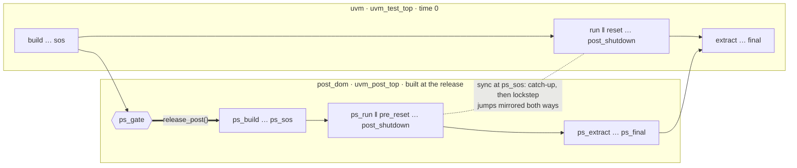

# Approach B — post domain

A post test in its own domain `post_dom` (`uvm_post_top`) joins the **running**
main test at `release_post()`. Its runtime phases are synced with the main
test's: catch-up first, lockstep after.



```systemverilog
// main env build_phase (or tb_top before run_test())
void'(install_post_domain("pcie_post_test"));                // +POST_TEST=<name> wins
void'(install_post_domain_by_type(my_env#(P1, P2)::get_type()));  // parameterized

// anywhere, typically the main test's main_phase
post_domain_controller::release_post("traffic ready");       // or pd_release_post()

// wait for it, from anywhere
bit started;
pd_wait_post_started(started);                               // started == 0: skipped
```

**What the post domain guarantees**

| Topic | Behaviour |
|:--|:--|
| Gate | `ps_gate` opens at `release_post()`; with no release the post domain is **skipped** at the end of the main runtime phases (`+POST_GATE_TIMEOUT=<ns>` turns that into a fatal) |
| Catch-up | post phases the main test has already finished run back to back |
| Lockstep | from the main test's current phase on, each runtime phase ends only when both sides dropped their objections |
| Jumps | mirrored after the sync: backward if the other side is past the target, forward if it is before it; retried for ~50 deltas while the other side is syncing, then `PSDOM/JUMP` warning. `+PSDOM_NO_JUMP_MIRROR` turns it off |
| Connects | a connect window is open from `ps_build` to the end of `ps_connect`; bindings are resolved with `uvm_post_top.do_resolve_bindings()` at `ps_eoe` |
| `ILLCRT` | UVM's "component created after build" fatal is caught for the post tree only |
| End | `ps_extract … ps_final` run before the main `extract … final` |

**Rules**

- Post default sequences: `ps_run_phase` or a runtime phase (`PSDOM/POST_DEFSEQ`).
- Main-tree ports connected to post-tree imps after the main `eoe` may not take
  effect; pass handles or use events / callbacks.
- Install up to the main `start_of_simulation` (later: `PSDOM/LATE`).

