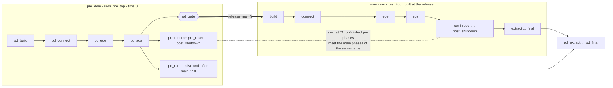

# Approach B — pre domain

The common boot lives in its own UVM domain `pre_dom` (`uvm_pre_top`, built at
time 0). The main test is built when the boot calls `release_main()`; the pre
tree keeps running alongside it until after the main test's `final`.



**Install, release, select the main test**

```systemverilog
// tb_top
initial begin
  pre_domain_controller ctl = install_pre_domain("boot_pre_test", "soc_test_a");
  ctl.gate_timeout_ns = 1_000_000;            // optional safety net
  run_test();                                 // no name: test chosen at the release
end

// anywhere (pre test, sequence, module, interface)
pre_domain_controller::release_main("boot done");   // or pd_release_main()
```

Main test, chosen at the main build *after* the command line is reprocessed:
`uvm_test_top` if `run_test()` already created it at time 0 → else
`+UVM_TESTNAME` → else the `main_test` argument of `install_pre_domain()`.

**Sync semantics**

| Situation | Behaviour |
|:--|:--|
| Pre runtime phases already done at T1 | not synced |
| Pre runtime phases not done at T1 | synced with the main phases of the same name; each synced phase ends only when **both** sides dropped their objections |
| Main jumps **forward** | skipped main phases are DONE; the pre side runs them alone and meets main at the target |
| Main jumps **backward** | the pre side ends its current phase and waits at the start of its next one until main is back there |

**Rules**

- Always-active `run_phase` loops in the pre tree must not hold objections.
- Do not wait for `release_main()` in the pre `build/connect/eoe/sos` — they
  run before the gate.
- Pre default sequences: `pd_run_phase` or a runtime phase, never `run_phase`
  (`PREDOM/PRE_DEFSEQ`).
- Domain-aware VIP that calls `set_domain()` in the pre tree is caught
  (`PREDOM/PRE_DOMAIN`); fix with `+PREDOM_ADOPT`, `+PREDOM_ADOPT_RETURN` or
  `+PREDOM_EXCLUDE`.

