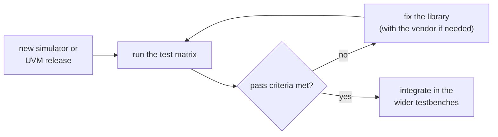

# Simulator and UVM library dependencies

The library works on top of behaviour that the UVM standard does not
define: building trees after time 0, restoring a checkpoint, and changing
the command line in the middle of a run. Some of that behaviour differs
between simulators and between UVM library versions.

This page lists the differences found so far, how each one is handled
today, and what is still open. The last section describes how new
simulator and UVM releases are qualified with the tests.

## Summary

| # | Issue | Depends on | Effect if not handled | Status |
|:--|:--|:--|:--|:--|
| 1 | The restored command line also contains the save run's arguments | simulator (Xcelium) | a save run's setting reappears after the restore, or wins over the restore's | handled; one difference remains |
| 2 | The global verbosity is kept in a list that is only appended to | UVM library (IEEE 2020) | the restore's `+UVM_VERBOSITY` is ignored; `MULTVERB` warning | handled, except `uvm-ieee-2020` |
| 3 | The global verbosity is set only once, at UVM start-up | UVM (all versions) | the restore's `+UVM_VERBOSITY` is ignored in `delayed_launch` | handled |
| 4 | The library writes UVM internal state | UVM library internals | breaks silently if a UVM release renames or changes them | relies on the tests |
| 5 | Dynamic test loading works differently | simulator (VCS DTL / Xcelium DTR) | different flows, targets and commands | handled, by flow |
| 6 | Log format and time units differ | simulator and UVM library | log scripts and expected-output text differ | documented |

## 1. Xcelium's restored command line includes the save run's arguments

**What happens.** After a restart, Xcelium reports the following command
line to UVM, in this order:
1. the restore's command line;
2. the save run's arguments that are not on the restore's;
3. the save run's whole command line again, followed by internal `xmsim`
   options.

VCS reports only the restore's command line.

**What it broke.** The same setting appeared more than once, and the save
run's value could win. Before the fix, `delayed_launch restore_cl` failed on
Xcelium with `UVM_ERROR`s, in both `FLOW=std` and `FLOW=dtr`.

**How it is handled.** Before the tables are rewritten, the command line is
collapsed to one occurrence per setting. The first occurrence is kept by
default, which is the restore's; `+NV_SOCV_CMDLINE_PRECEDENCE=last` keeps the
last one instead. The same code runs on both simulators. See
[cmdline_strategy.md](cmdline_strategy.md#repeated-arguments-precedence).

**What still differs.** A setting given only on the save run is still
reported by Xcelium, so it survives a repopulate on Xcelium but not on VCS.
The `restore_cl_drop` targets expect different results per simulator.

**Open.**
- If the save-only difference needs to be controlled, use the same approach
  as for repeated arguments: a plusarg that selects the behaviour.

## 2. IEEE 2020 UVM keeps the global verbosity in a list that is only appended to

**What happens.** In the IEEE 2020 libraries, `uvm_root::m_check_verbosity()`
reads `+UVM_VERBOSITY` into the static list `uvm_cmdline_verbosity::settings`
and uses its first entry. It adds to the list without emptying it. The list
is filled at time 0 and saved in the checkpoint. UVM 1.2 has no such list
and reads the tables directly.

**What it broke.** When the library applied the verbosity again after a
restore, the save run's value stayed first in the list and was used.
`MULTVERB` warnings were printed, with one more entry each call.

**How it is handled.** The library empties the list before calling
`m_check_verbosity()`, under `` `ifdef UVM_VERSION_POST_2020_1_0 ``.

**Coverage by library:**

| Library | Has the list | Defines `UVM_VERSION_POST_2020_1_0` | Result |
|:--|:--|:--|:--|
| VCS `uvm-1.1`, `uvm-1.2` | no | no | correct (nothing to fix) |
| VCS `uvm-ieee` (2017) | no | no | correct (nothing to fix) |
| VCS `uvm-ieee-2020` | yes | **no** | **not fixed**: `MULTVERB`, the restore's value is ignored |
| VCS `uvm-ieee-2020-2.0`, `uvm-ieee-2020-3.1` | yes | yes | fixed |
| Xcelium CDNS-IEEE-20 | yes | yes | fixed |

**Open.**
- `uvm-ieee-2020` has the list but does not define
  `UVM_VERSION_POST_2020_1_0`, so the fix is not applied there.

## 3. UVM sets the global verbosity only once

**What happens.** On every UVM version, the global verbosity is set during
UVM start-up (`uvm_root::new()` in UVM 1.2, `uvm_init()` in IEEE).
`run_test()` does not set it again. Components created later copy their
parent's level.

**What it broke.** In `delayed_launch`, `uvm_root` exists from time 0 of the
save run. After a restore, `run_test()` built the test with the save run's
verbosity, and the restore's `+UVM_VERBOSITY` was ignored on both
simulators.

**How it is handled.** The library applies the global verbosity right after
the repopulate, before `run_test()`. See
[cmdline_strategy.md](cmdline_strategy.md#verbosity-on-save-and-restore).

**Open.**
- Look for other settings that UVM reads only at start-up, and check them
  in the same way after a restore.

## 4. UVM internal state the library writes

The library uses UVM internals that are not part of the standard:

| Internal | Used for |
|:--|:--|
| `uvm_cmdline_processor` `m_argv`, `m_plus_argv`, `m_uvm_argv` (`protected`) | rewriting the command-line tables |
| `uvm_root::m_check_verbosity()` | applying the global verbosity again |
| `uvm_cmdline_verbosity::settings` (IEEE 2020) | issue 2 |
| `uvm_root::m_current_phase` | config precedence in `pd_build` and `ps_build` |
| `uvm_root::m_do_*_settings()` | the replay functions follow their code |

**Open.**
- A UVM release can rename or change any of these. The tests below detect
  it; the replay functions must then follow the changed UVM code.

## 5. Dynamic test loading differs per simulator

| | VCS DTL (`FLOW=dtl`) | Xcelium DTR (`FLOW=dtr`) |
|:--|:--|:--|
| Package load | `$dtl_load` after the restore | linked with the restored snapshot before the restart (`+dtr_pkg`) |
| `run_*` targets | available | not available |
| UVM package | compiled separately from `$VCS_HOME/etc/$(UVM_VER)` | from `-uvmhome` |

Details are in [save_restore.md](save_restore.md).

**Open.**
- Keep the static and dynamic compiles on the same UVM version and compile
  options; a mismatch is not always reported by the tool.

## 6. Log format and time units

| | VCS | Xcelium |
|:--|:--|:--|
| Time unit in reports | fs (`@50000000` = 50 ns) | ps (`@50000` = 50 ns) |
| Restore marker | `<50001000>` | `<50001>` |
| Save marker | `saving checkpoint ckpt_vcs/<name>.chk` | `saving checkpoint <name>` |
| `[PHASE]` lines | phase name left-aligned | phase name right-aligned |

Some UVM messages also differ between libraries. For example, `TPREGR`
prints `'cpu_agent'` with UVM 1.2 and `'cpu_agent'/'cpu_agent'` with IEEE.

**Open.**
- Log checks and expected output should match on message IDs and values,
  not on times or column alignment.

## Qualifying new releases

A new simulator or UVM release is qualified with these tests **before** it
is used in the wider testbenches:

Differences are handled in two ways, as for the issues above:

| Difference | Control | What it controls | Example |
|:--|:--|:--|:--|
| Simulator behaviour | a run-time plusarg, `+NV_SOCV_CMDLINE_PRECEDENCE=first\|last` | which occurrence of a repeated setting is kept: `first` (default, the restore's) or `last` (issue 1) | `make restore_cl SIM=xrun ARGS=+NV_SOCV_CMDLINE_PRECEDENCE=last` |
| UVM library version | a compile-time guard on a version macro defined by the UVM library, `` `ifdef UVM_VERSION_POST_2020_1_0 `` | whether the version-specific fix is compiled; other versions keep the code they used before (issue 2) | `` `ifdef UVM_VERSION_POST_2020_1_0 `` / `uvm_cmdline_verbosity::settings.delete();` / `` `endif `` |

Some problems are in the simulator or the UVM library itself and need the
vendor. Simulator vendors usually qualify their releases against test suites
provided by their users; these tests can be part of those suites, so a new
release is checked against this behaviour before it ships.

### The test matrix

The test folders (`delayed_launch`, `pre_domain`, `post_domain`) are the
contract tests. Each has `CL_EXPECT` checks and a clean report summary as its
pass criteria, so no separate suite is needed. Run across the matrix below,
they detect a new simulator or UVM release that behaves differently:

| Axis | Switch | What it controls | Example |
|:--|:--|:--|:--|
| Simulator | `SIM=vcs\|xrun` | which simulator compiles and runs | `make compile save restore SIM=xrun` |
| UVM library (VCS) | `UVM_VER=<lib>`, passed as `-ntb_opts <lib>`; `uvm-1.2` (default), `uvm-ieee-2020`, `uvm-ieee-2020-2.0`, `uvm-ieee-2020-3.1` | the UVM library VCS compiles with | `make compile save restore SIM=vcs UVM_VER=uvm-ieee-2020-3.1` |
| UVM library (Xcelium) | `UVM_HOME=<path>`, passed as `-uvmhome <path>` | the UVM library Xcelium compiles with | `make compile save restore SIM=xrun UVM_HOME=CDNS-IEEE` |
| Flow | `FLOW=std\|dtl\|dtr` | plain save/restore, VCS Dynamic Test Load (`dtl`) or Xcelium Dynamic Test Reload (`dtr`) | `make compile save restore SIM=xrun FLOW=dtr` |
| Target | `save` / `restore`, `save_cl` / `restore_cl`, `restore_cl_drop`, `restore_cl_keep`, `save_c` / `restore_c`, `restore_c_keep` (`delayed_launch`) | which checkpoint and which restore command line | `make save_cl restore_cl_drop` |
| Repeated arguments | `ARGS=+NV_SOCV_CMDLINE_PRECEDENCE=first\|last` | which occurrence of a repeated setting is kept | `make restore_cl SIM=xrun ARGS=+NV_SOCV_CMDLINE_PRECEDENCE=last` |
| Global verbosity | `VERBOSITY=<verb>`, passed as `+UVM_VERBOSITY=<verb>` (default `UVM_MEDIUM`) | the global verbosity; give the restore a different value from the save run's | `make restore VERBOSITY=UVM_HIGH` |

A run passes when:
- every `[CL_EXPECT]` line reports `0 failed`;
- the summary shows `UVM_WARNING : 0`, `UVM_ERROR : 0`, `UVM_FATAL : 0`, and
  in `post_domain` exactly 25 caught `UVM_FATAL`s (the ILLCRT ones);
- the library's own lines (`REPOPULATE` / `APPEND`, `REAPPLY`) are the same as
  on the reference run.

Still to do:
- Add `make` targets that run the matrix and collect pass/fail per cell.
- Add the restore `+UVM_VERBOSITY` case to the `*_cl` targets, so issues 2
  and 3 are checked automatically rather than only through the absence of
  `MULTVERB`.
- Decide the supported list of simulator and UVM releases, and note it in
  the README.
